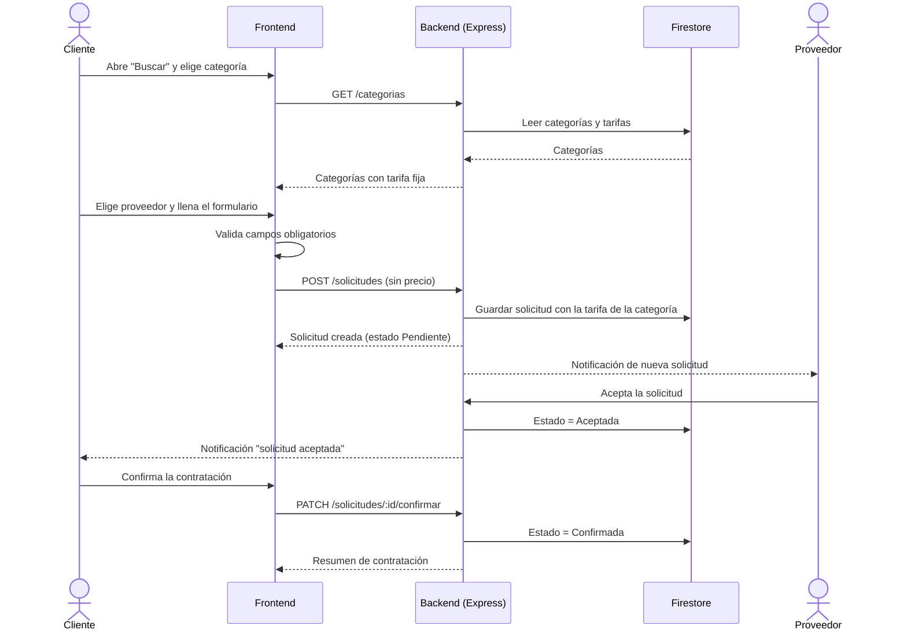
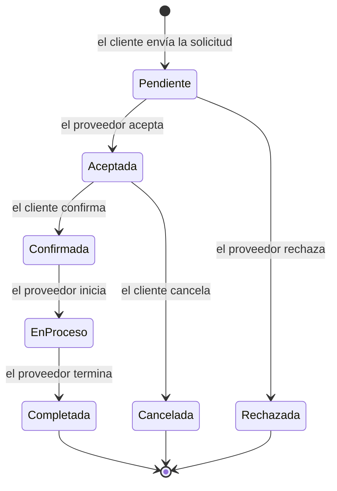
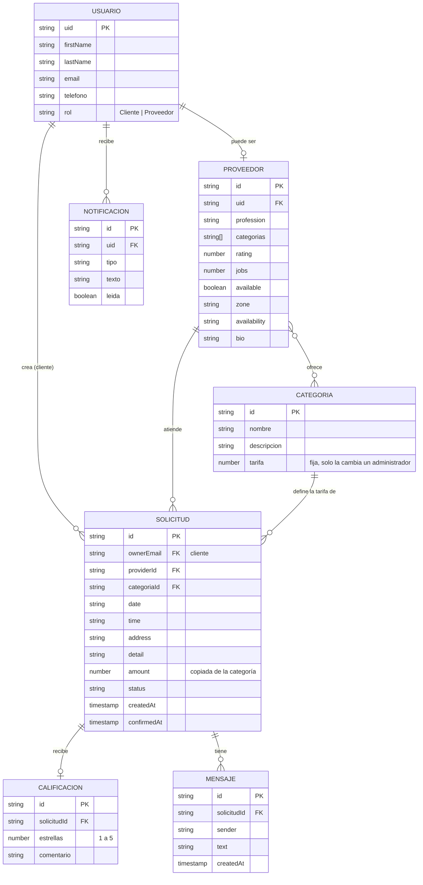
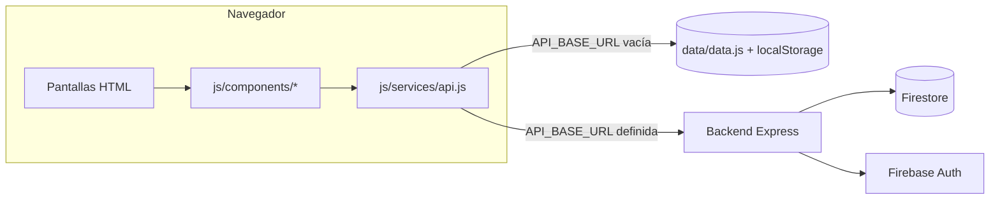

# 🌐 HogarFix
**Calidad en cada arreglo**

Proyecto enfocado en conectar a personas que necesitan servicios para el hogar con proveedores calificados, mediante una plataforma digital accesible, organizada y transparente que utiliza un modelo de tarifa fija por categoría de servicio.

## 📑 Contenido

1. [Objetivo general](#-1-objetivo-general)
2. [Contexto de uso](#-2-contexto-de-uso)
3. [Requerimientos del sistema](#-3-requerimientos-del-sistema)
4. [Diagramas UML](#-4-diagramas-uml)
5. [Prototipo en Figma](#-5-prototipo-en-figma)
6. [Modelo de datos](#%EF%B8%8F-6-modelo-de-datos)
7. [Documentación del sistema](#-7-documentación-del-sistema)
8. [Instalación y ejecución](#-8-instalación-y-ejecución)
9. [Despliegue](#-9-despliegue)
10. [Seguridad y archivos sensibles](#-10-seguridad-y-archivos-sensibles)
11. [Estado del proyecto](#-11-estado-del-proyecto)

## 👥 Integrantes

- Laura Valentina Bojacá Sánchez – 1202561
- Sebastián Gómez Ramírez – 1202821
- Juan José Gutiérrez – 1202
- Sebastián Torres – 1202

## 🎯 1. Objetivo general

Desarrollar una plataforma digital que facilite la contratación de servicios para el hogar, como plomería, electricidad, jardinería y aseo general, conectando a clientes con proveedores calificados mediante un sistema de tarifas fijas por categoría. HogarFix busca solucionar los problemas de informalidad, falta de transparencia en los precios, incertidumbre sobre la disponibilidad de los proveedores y dificultades para encontrar personal de confianza. Para ello, permite consultar los precios antes de realizar una solicitud, programar los servicios, gestionar su aceptación y seguimiento, recibir notificaciones y calificar a los proveedores, mejorando así la confianza, la organización y la eficiencia durante el proceso de contratación.

## 🌍 2. Contexto de uso

HogarFix está dirigido a dos tipos principales de usuarios: los clientes que necesitan contratar servicios de reparación o mantenimiento para su hogar y los proveedores que ofrecen servicios técnicos u operativos, como plomería, electricidad, jardinería y aseo general.

Los clientes pueden utilizar la plataforma desde un dispositivo web o móvil para registrarse, consultar las categorías disponibles y sus tarifas fijas, solicitar un servicio indicando la fecha, hora, ubicación y descripción del trabajo, consultar los proveedores que aceptaron la solicitud, confirmar el servicio y calificar la atención recibida. Por su parte, los proveedores pueden gestionar su perfil, consultar las solicitudes correspondientes a sus especialidades, aceptarlas o rechazarlas, administrar sus servicios y consultar su historial e ingresos. Ambos usuarios pueden recibir notificaciones y acceder al módulo de soporte cuando necesiten ayuda.

## 📋 3. Requerimientos del sistema

### 3.1 Requerimientos funcionales

**RF01. Registro de usuarios:** El sistema debe permitir registrar usuarios con sus datos personales y seleccionar el tipo de cuenta: cliente o proveedor.

**RF02. Inicio de sesión:** El sistema debe permitir iniciar sesión mediante correo electrónico o número celular y contraseña.

**RF03. Recuperación de contraseña:** El sistema debe permitir recuperar la contraseña mediante un código de verificación enviado al correo registrado.

**RF04. Consulta de categorías y tarifas:** El sistema debe mostrar las categorías de servicios para el hogar y sus respectivas tarifas fijas.

**RF05. Solicitud de servicios:** El sistema debe permitir al cliente solicitar un servicio indicando la categoría, fecha, hora, ubicación y descripción del trabajo requerido.

**RF06. Visualización de proveedores:** El sistema debe permitir al cliente consultar los proveedores que aceptaron su solicitud y sus calificaciones promedio.

**RF07. Confirmación del servicio:** El sistema debe permitir al cliente confirmar un servicio aceptado por un proveedor y generar un resumen tipo factura con los datos de la contratación.

**RF08. Gestión de solicitudes:** El sistema debe permitir al proveedor consultar las solicitudes de sus categorías de servicio y aceptarlas o rechazarlas sin modificar la tarifa fija.

**RF09. Historial de servicios:** El sistema debe permitir a clientes y proveedores consultar el historial y el estado de los servicios.

**RF10. Calificación del proveedor:** El sistema debe permitir al cliente calificar al proveedor de una a cinco estrellas y dejar un comentario una vez finalizado el servicio.

**RF11. Notificaciones:** El sistema debe notificar a los usuarios sobre los cambios de estado de las solicitudes y los recordatorios de los servicios programados.

**RF12. Soporte:** El sistema debe ofrecer preguntas frecuentes y permitir enviar mensajes al equipo de soporte.

**RF13. Gestión del perfil:** El sistema debe permitir a los usuarios consultar y editar su información personal y, en el caso del proveedor, gestionar sus categorías y disponibilidad.

**RF14. Consulta de ingresos:** El sistema debe permitir al proveedor consultar sus ingresos acumulados y su desglose por periodo a partir de los servicios pagados.

### 3.2 Requerimientos no funcionales

**RNF01. Usabilidad:** La interfaz debe ser intuitiva y facilitar la navegación de clientes y proveedores.

**RNF02. Diseño adaptable:** La plataforma debe presentar una interfaz responsive que se adapte a diferentes tamaños de pantalla y dispositivos.

**RNF03. Seguridad:** El sistema debe proteger la información de los usuarios mediante autenticación y reglas de acceso según el rol y los permisos correspondientes.

**RNF04. Integridad de tarifas:** Las tarifas deben mantenerse fijas según la categoría del servicio y no deben poder ser modificadas por el cliente ni por el proveedor durante la solicitud.

**RNF05. Sincronización:** La información de las solicitudes, asignaciones, servicios y notificaciones debe mantenerse sincronizada en tiempo real mediante Firebase.

**RNF06. Persistencia:** Los datos registrados deben almacenarse de forma persistente en la base de datos para permitir su consulta posterior.

**RNF07. Organización modular:** El sistema debe separar las funcionalidades de autenticación, gestión del cliente, gestión del proveedor, servicios, notificaciones y soporte para facilitar su mantenimiento y evolución.

## 🧠 4. Diagramas UML

### 4.1 Diagrama de casos de uso

Representa las funcionalidades principales de HogarFix y cómo interactúan con ellas el cliente, el proveedor y el sistema (que envía las notificaciones automáticas).


### 4.2 Diagrama de secuencia: solicitud de un servicio a tarifa fija



### 4.3 Estados de una solicitud



## 🎨 5. Prototipo en Figma

[Prototipo público de HogarFix en Figma](https://www.figma.com/design/QyHoaWKuAh0UaloG1XTRh8/HogarFix?node-id=532-421&t=BvIlGCNIAR99rQAw-1)

## 🗄️ 6. Modelo de datos

Modelo de las colecciones de Firestore que usa el frontend. Los nombres de campo coinciden con `data/schema.json` y con los datos de demostración de `data/data.js`.



**Tarifas fijas actuales**

| Categoría | ID | Tarifa |
| --- | --- | --- |
| Plomería | `plomeria` | $35.000 |
| Electricidad | `electricidad` | $40.000 |
| Jardinería | `jardineria` | $40.000 |
| Aseo general | `aseo-general` | $35.000 |

## 🧩 7. Documentación del sistema

### 7.1 Tecnologías

| Capa | Tecnología |
| --- | --- |
| Frontend | HTML5, CSS3 (diseño responsive con media queries), JavaScript (módulos ES) |
| Backend | Node.js + Express (en desarrollo) |
| Base de datos y autenticación | Firebase Firestore y Firebase Authentication (en desarrollo) |
| Diseño | Figma |
| Control de versiones y publicación | Git, GitHub y GitHub Pages |
| Formato de código | Prettier (`.prettierrc.json`) |

### 7.2 Arquitectura



- **Frontend:** cada pantalla es un archivo HTML que carga `js/main.js`. `main.js` importa los módulos de `js/components/`, y cada módulo actúa solo si encuentra sus elementos en la página.
- **Capa de servicios (`js/services/api.js`):** es el único punto por donde el frontend pide o envía datos. Si `js/config.js` no tiene URL de backend, funciona en **modo demostración** con `data/data.js` y `localStorage`. Cuando el backend esté publicado, basta con poner su URL en `API_BASE_URL`; las pantallas no cambian.
- **Backend:** API REST en Express que valida los datos, aplica las reglas de negocio (por ejemplo, que la tarifa venga de la categoría) y se comunica con Firestore.
- **Base de datos:** Firestore guarda usuarios, proveedores, categorías, solicitudes, calificaciones, mensajes y notificaciones (ver sección 6).

### 7.3 Estructura de carpetas

```
HogarFix/
├── index.html                 Página pública (landing)
├── login.html, registro.html  Acceso
├── app.html                   Panel del cliente
├── buscar.html                Catálogo de categorías y búsqueda de proveedores
├── perfil-proveedor.html      Perfil del proveedor y formulario de solicitud
├── reserva.html               Resumen de contratación y confirmación
├── solicitudes.html           Historial de servicios del cliente
├── mi-perfil.html             Perfil editable del cliente
├── chat.html                  Chat del cliente
├── inicio-proveedor.html      Panel del proveedor
├── solicitudes-proveedor.html Solicitudes recibidas por el proveedor
├── detalle-proveedor.html     Detalle de una solicitud (proveedor)
├── mi-perfil-proveedor.html   Perfil editable del proveedor
├── ingresos-proveedor.html    Ingresos del proveedor
├── mensajes-proveedor.html    Chat del proveedor
├── assets/                    Logos, íconos SVG e imágenes
├── css/styles.css             Estilos globales y media queries
├── data/
│   ├── data.js                Datos de demostración (categorías, proveedores, reseñas…)
│   └── schema.json            Esquema de los formularios y entidades
├── js/
│   ├── config.js              URL del backend (vacía = modo demostración)
│   ├── main.js                Navegación, accesibilidad, sesión y pantallas del proveedor
│   ├── utils.js               Formato de precios y fechas, estados de carga y error
│   ├── services/api.js        Capa de servicios (backend o demostración)
│   └── components/
│       ├── catalogo.js        Categorías y tarifas fijas (ISSUE 10)
│       ├── proveedores.js     Listado y perfil de proveedores (ISSUE 12)
│       ├── solicitud.js       Formulario de solicitud con validación (ISSUE 11)
│       ├── resumen.js         Resumen y confirmación de contratación (ISSUE 13)
│       ├── historial.js       Historial con filtros por estado y fecha (ISSUE 14)
│       ├── form-data.js       Lectura y validación de formularios contra schema.json
│       ├── panel-proveedor.js Panel y solicitudes del proveedor autenticado (#29)
│       ├── perfil.js          Perfil editable de cliente y proveedor (#30, #31)
│       ├── password.js        Mostrar/ocultar y requisitos de contraseña (#32)
│       └── login.js, registro.js, buscar.js, chat.js
├── .github/workflows/pages.yml  Publicación automática en GitHub Pages
├── .env.example               Variables de entorno de ejemplo
└── .prettierrc.json           Formato común del código
```

### 7.4 Endpoints principales

Contrato que consume el frontend desde `js/services/api.js`. Todas las rutas cuelgan de `API_BASE_URL` y responden JSON. Las rutas de solicitudes requieren el encabezado `Authorization: Bearer <token>` del usuario autenticado.

| Método | Ruta | Uso | Respuesta |
| --- | --- | --- | --- |
| GET | `/categorias` | Catálogo de categorías y tarifas fijas | `[{ id, nombre, descripcion, tarifa }]` |
| GET | `/proveedores?categoria=&disponible=` | Proveedores, con filtros opcionales | `[{ id, name, profession, categorias, rating, available, … }]` |
| GET | `/proveedores/:id` | Perfil del proveedor con sus reseñas | `{ …proveedor, resenas: [] }` |
| GET | `/solicitudes` | Solicitudes del cliente autenticado | `[{ id, service, provider, date, time, status, amount, … }]` |
| GET | `/solicitudes/:id` | Detalle de una solicitud | `{ …solicitud }` |
| POST | `/solicitudes` | Crear solicitud `{ proveedorId, categoriaId, date, time, address, detail }` | Solicitud creada, estado `Pendiente` |
| PATCH | `/solicitudes/:id/confirmar` | El cliente confirma una solicitud `Aceptada` | Solicitud con estado `Confirmada` |
| GET | `/pagos/metodos` | Métodos de pago disponibles | `[{ id, nombre, descripcion, tipo }]` |
| GET | `/proveedor/solicitudes` | Solicitudes del proveedor autenticado | `[{ …solicitud }]` |
| PATCH | `/solicitudes/:id/estado` | El proveedor cambia el estado `{ estado }` | Solicitud actualizada |
| GET | `/perfil` | Perfil del usuario autenticado | `{ firstName, lastName, email, role, phone, bio, photo, … }` |
| PUT | `/perfil` | Guardar cambios del propio perfil | Perfil actualizado |

Reglas importantes para el backend:

- `POST /solicitudes` **no recibe precio**: el servidor copia la tarifa de la categoría (RNF04).
- `POST /solicitudes` recibe `metodoPagoId` (`efectivo`, `nequi`, `pse` o `tarjeta`) y debe guardar `paymentMethod` y `paymentStatus`. Para coordinar con el backend: la solicitud que espera el frontend tiene `id, ownerEmail, clientName, providerId, providerEmail, categoriaId, service, date, time, address, detail, amount, paymentMethod { id, nombre, tipo }, paymentStatus, status, createdAt`.
- **Pagos:** el cobro en línea lo hará la pasarela que defina el equipo (con tokenización). HogarFix nunca recibe ni guarda números de tarjeta ni CVV, y no marca pagos como exitosos sin la confirmación real de la pasarela.
- `GET /proveedor/solicitudes` y `PATCH /solicitudes/:id/estado` deben filtrar por el proveedor autenticado: un proveedor nunca ve ni cambia solicitudes de otro.
- `PUT /perfil` toma el usuario del token, nunca del cuerpo: cada quien solo edita su propio perfil. Con Firebase, el perfil va en `usuarios/{uid}` y la foto en Firebase Storage (`perfiles/{uid}.jpg`).
- Los errores deben responder con un código HTTP y `{ "message": "texto para el usuario" }`; el frontend muestra ese mensaje.
- Pendientes del equipo de backend: autenticación, recuperación de contraseña, gestión de solicitudes del proveedor, calificaciones, notificaciones e ingresos.

### 7.5 Funcionalidades del frontend

- **Catálogo y tarifas:** `buscar.html` muestra las cuatro categorías con su tarifa fija; al elegir una se filtran los proveedores. La landing toma los mismos precios.
- **Proveedores:** tarjetas con especialidad, calificación, distancia y disponibilidad; filtros por texto, categoría y disponibilidad; perfil con reseñas.
- **Solicitud de servicio:** formulario con categoría, fecha (desde hoy y hasta 60 días), hora, dirección y descripción; validación por campo con mensajes; la tarifa se muestra y no se puede editar.
- **Resumen de contratación:** datos del cliente, del proveedor, del servicio y la tarifa, tipo factura, con opción de imprimir. Si el proveedor ya aceptó, el cliente confirma desde ahí.
- **Métodos de pago:** al solicitar un servicio el cliente elige efectivo, Nequi, PSE o tarjeta; ve un resumen antes de enviar; la elección se conserva si recarga la página y aparece en el resumen de contratación y en el historial.
- **Perfiles:** el cliente (`mi-perfil.html`) y el proveedor (`mi-perfil-proveedor.html`) editan sus datos y foto. El proveedor elige especialidades, horarios y disponibilidad, y con eso aparece en las búsquedas.
- **Panel del proveedor:** solo muestra solicitudes reales dirigidas a ese proveedor; un proveedor nuevo ve todo en cero y un mensaje de estado vacío.
- **Contraseñas:** botón de ojo para mostrar u ocultar, y requisitos (8 caracteres, mayúscula, minúscula, número y carácter especial) que se marcan en vivo; no se puede crear la cuenta hasta cumplirlos y que coincida la confirmación.
- **Historial:** filtros por estado y rango de fechas, orden, detalles desplegables y actualización automática (cada 30 s, al volver a la pestaña o cuando cambia en otra pestaña).
- **Estados de carga y error** en todas las consultas, con botón para reintentar.
- **Diseño responsive** probado a 360 px (celular), 768 px (tablet) y 1280 px (escritorio), sin desbordamiento horizontal.
- **Accesibilidad:** enlace para saltar al contenido, botones para aumentar el texto y alto contraste, etiquetas ARIA y navegación por teclado.

## 🚀 8. Instalación y ejecución

**Requisitos:** un navegador actualizado y Visual Studio Code con la extensión **Live Server** (o cualquier servidor estático). No hace falta instalar dependencias.

1. Clona el repositorio:
   ```bash
   git clone https://github.com/Tecnologias-2026-2/HogarFix.git
   cd HogarFix
   ```
2. Abre la carpeta en Visual Studio Code.
3. Clic derecho en `index.html` → **Open with Live Server**. Se abre en `http://127.0.0.1:5500`.

> Abrir el HTML con doble clic (`file://`) no funciona: los módulos de JavaScript y `schema.json` necesitan un servidor.

Alternativa sin VS Code: `npx serve .` o `python -m http.server 5500` desde la carpeta del proyecto.

### Recorrido de demostración

1. En `index.html` elige **Soy Cliente**, regístrate con datos de prueba (no uses contraseñas reales).
2. En **Buscar** elige una categoría, abre un perfil y envía una solicitud.
3. Revisa el resumen y luego **Mis solicitudes**.
4. Para ver el flujo completo con un proveedor: regístrate como proveedor, entra a **Mi Perfil**, elige una especialidad y guarda. Desde ese momento apareces en **Buscar**.
5. Entra como cliente, busca a ese proveedor, elige un método de pago y envía la solicitud. Luego entra como proveedor: la verás en **Mis solicitudes** y podrás aceptarla.
6. Vuelve a entrar como cliente: la solicitud aparece *Por confirmar* y puedes confirmar la contratación.
7. Para mostrar los estados de error, agrega `?simularError=1` a la URL (por ejemplo `buscar.html?simularError=1`).

### Conectar el backend

Cuando el backend esté disponible, edita `js/config.js`:

```js
export const API_BASE_URL = "http://localhost:3000/api"; // o la URL publicada
```

### Modo demostración

Mientras `API_BASE_URL` esté vacía, las cuentas, los perfiles, la sesión, las solicitudes y los mensajes se guardan en el `localStorage`/`sessionStorage` del navegador. Solo funcionan en el mismo navegador y dispositivo donde se crearon y no se comparten con otros usuarios.

## 🌍 9. Despliegue

El frontend se publica en **GitHub Pages** con el flujo `.github/workflows/pages.yml`, que se ejecuta en cada push a `main` (o a mano desde la pestaña *Actions*).

Configuración inicial (una sola vez, la hace quien administra el repositorio): **Settings → Pages → Build and deployment → Source: GitHub Actions**.

El sitio queda en `https://tecnologias-2026-2.github.io/HogarFix/`.

## 🔒 10. Seguridad y archivos sensibles

- `.gitignore` excluye `.env` y sus variantes; usa `.env.example` como plantilla y nunca subas el `.env` real.
- Las contraseñas deben tener mínimo 8 caracteres, mayúscula, minúscula, número y carácter especial.
- No se piden ni guardan datos de tarjetas: el pago en línea se hará en la pasarela de pagos.
- Las contraseñas de las cuentas de demostración no se guardan en texto plano: se derivan con PBKDF2 (Web Crypto) antes de guardarlas en el navegador.
- La configuración web de Firebase (`apiKey`, `projectId`…) es pública por diseño, pero el acceso a los datos debe protegerse con **reglas de seguridad de Firestore** por usuario y rol.
- Las claves privadas del backend (cuentas de servicio de Firebase) deben ir solo en variables de entorno del servidor, nunca en el repositorio.
- Lista de revisión antes de cada entrega: sin archivos `.env`, sin credenciales de cuentas de servicio y sin archivos de prueba (`prueba.html`, `prueba-firebase.js`) en `main`.

## 📌 11. Estado del proyecto

| Issue | Tema | Estado |
| --- | --- | --- |
| 08 | Adaptación del diseño a HTML, CSS y JS | ✅ Código formateado y organizado, íconos de categorías corregidos |
| 09 | Diseño responsive | ✅ Probado en celular, tablet y escritorio |
| 10 | Catálogo de categorías y tarifas | ✅ Desde la capa de servicios |
| 11 | Formulario de solicitud | ✅ Validación y envío por la capa de servicios |
| 12 | Visualización de proveedores | ✅ Desde la capa de servicios, con carga y error |
| 13 | Confirmación y resumen de contratación | ✅ |
| 14 | Historial de servicios del cliente | ✅ Filtros por estado y fecha |
| 28 | Documentación y entrega final | ✅ Este README |
| #29 (34) | Solicitudes iniciales del panel del proveedor | ✅ Sin datos de prueba, solo las del proveedor autenticado |
| #30 (35) | Perfil del cliente | ✅ Foto, datos, descripción y método de pago preferido |
| #31 (36) | Perfil del proveedor | ✅ Foto, contacto, especialidades, horarios y disponibilidad |
| #32 (37) | Contraseñas en el registro | ✅ Mostrar/ocultar y requisitos en vivo |
| #32 (38) | Flujo de métodos de pago | ✅ Interfaz lista; falta la pasarela que defina el equipo |
| 02-07, 15-27 | Backend, Firebase, autenticación, calificaciones, notificaciones | En desarrollo por el equipo de backend y base de datos |

Mientras el backend no esté publicado, el frontend funciona completo en modo demostración y queda listo para conectarse cambiando una sola línea en `js/config.js`.
