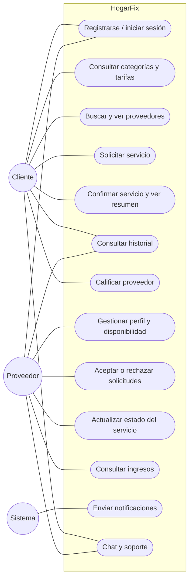
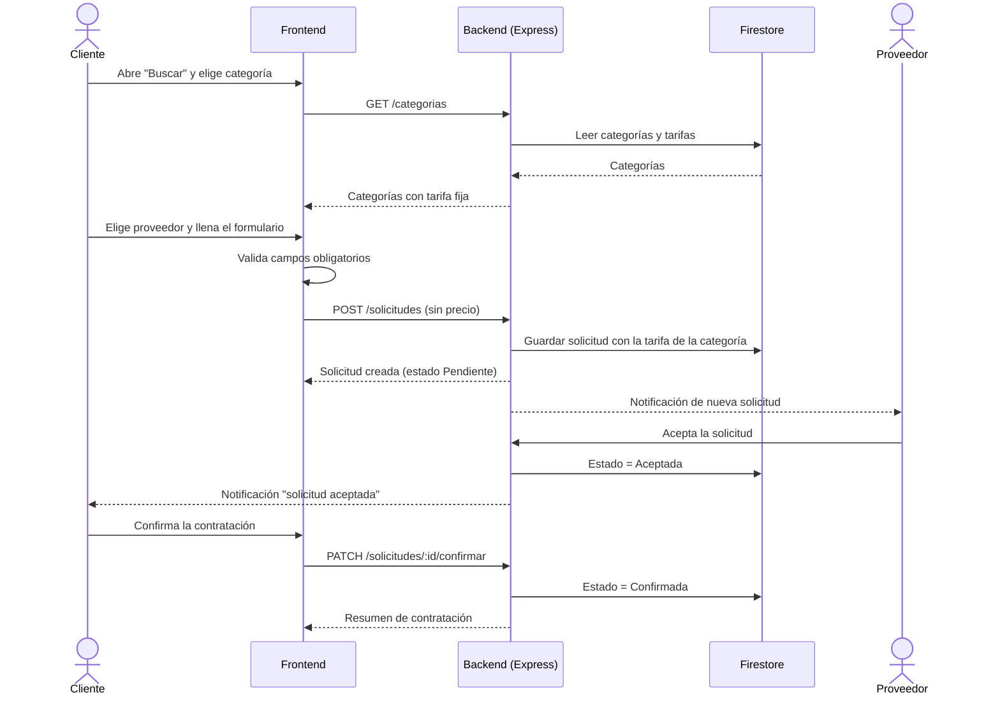
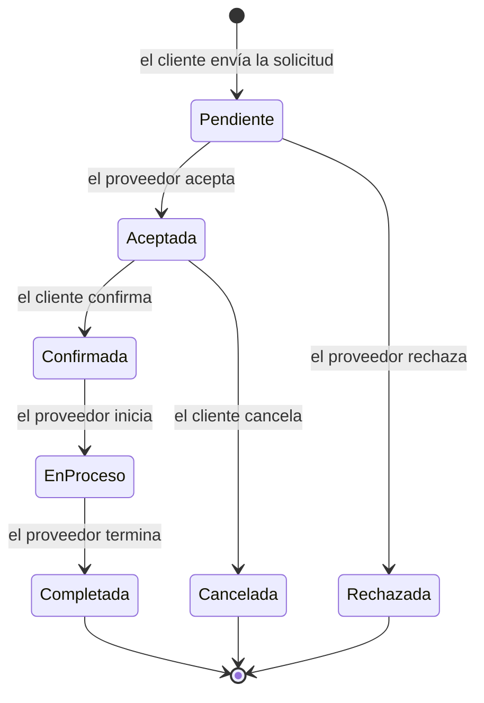
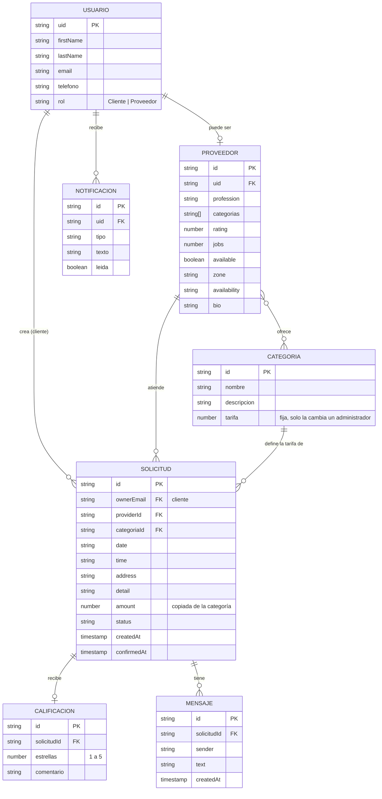

# 🌐 HogarFix
**Calidad en cada arreglo**

Proyecto enfocado en conectar a personas que necesitan servicios para el hogar con proveedores calificados, mediante una plataforma digital accesible, organizada y transparente que utiliza un modelo de tarifa fija por categoría de servicio.

## 📑 Contenido

1. [Objetivo general](#-1-objetivo-general)
2. [Contexto de uso](#-2-contexto-de-uso)
3. [Requerimientos del sistema](#-3-requerimientos-del-sistema)
4. [Diagramas UML](#-4-diagramas-uml)
5. [Prototipo en Figma](#-5-prototipo-en-figma)
6. [Modelo de datos](#%EF%B8%8F-6-modelo-de-datos)
7. [Documentación del sistema](#-7-documentación-del-sistema)
8. [Instalación y ejecución](#-8-instalación-y-ejecución)
9. [Despliegue](#-9-despliegue)
10. [Seguridad y archivos sensibles](#-10-seguridad-y-archivos-sensibles)
11. [Estado del proyecto](#-11-estado-del-proyecto)

## 👥 Integrantes

- Laura Valentina Bojacá Sánchez – 1202561
- Sebastián Gómez Ramírez – 1202821
- Juan José Gutiérrez – 1202
- Sebastián Torres – 1202

## 🎯 1. Objetivo general

Desarrollar una plataforma digital que facilite la contratación de servicios para el hogar, como plomería, electricidad, jardinería y aseo general, conectando a clientes con proveedores calificados mediante un sistema de tarifas fijas por categoría. HogarFix busca solucionar los problemas de informalidad, falta de transparencia en los precios, incertidumbre sobre la disponibilidad de los proveedores y dificultades para encontrar personal de confianza. Para ello, permite consultar los precios antes de realizar una solicitud, programar los servicios, gestionar su aceptación y seguimiento, recibir notificaciones y calificar a los proveedores, mejorando así la confianza, la organización y la eficiencia durante el proceso de contratación.

## 🌍 2. Contexto de uso

HogarFix está dirigido a dos tipos principales de usuarios: los clientes que necesitan contratar servicios de reparación o mantenimiento para su hogar y los proveedores que ofrecen servicios técnicos u operativos, como plomería, electricidad, jardinería y aseo general.

Los clientes pueden utilizar la plataforma desde un dispositivo web o móvil para registrarse, consultar las categorías disponibles y sus tarifas fijas, solicitar un servicio indicando la fecha, hora, ubicación y descripción del trabajo, consultar los proveedores que aceptaron la solicitud, confirmar el servicio y calificar la atención recibida. Por su parte, los proveedores pueden gestionar su perfil, consultar las solicitudes correspondientes a sus especialidades, aceptarlas o rechazarlas, administrar sus servicios y consultar su historial e ingresos. Ambos usuarios pueden recibir notificaciones y acceder al módulo de soporte cuando necesiten ayuda.

## 📋 3. Requerimientos del sistema

### 3.1 Requerimientos funcionales

**RF01. Registro de usuarios:** El sistema debe permitir registrar usuarios con sus datos personales y seleccionar el tipo de cuenta: cliente o proveedor.

**RF02. Inicio de sesión:** El sistema debe permitir iniciar sesión mediante correo electrónico o número celular y contraseña.

**RF03. Recuperación de contraseña:** El sistema debe permitir solicitar por correo instrucciones para restablecer la contraseña mediante Firebase Authentication.

**RF04. Consulta de categorías y tarifas:** El sistema debe mostrar las categorías de servicios para el hogar y sus respectivas tarifas fijas.

**RF05. Solicitud de servicios:** El sistema debe permitir al cliente solicitar un servicio indicando la categoría, fecha, hora, ubicación y descripción del trabajo requerido.

**RF06. Visualización de proveedores:** El sistema debe permitir al cliente consultar los proveedores que aceptaron su solicitud y sus calificaciones promedio.

**RF07. Confirmación del servicio:** El sistema debe permitir al cliente confirmar un servicio aceptado por un proveedor y generar un resumen tipo factura con los datos de la contratación.

**RF08. Gestión de solicitudes:** El sistema debe permitir al proveedor consultar las solicitudes de sus categorías de servicio y aceptarlas o rechazarlas sin modificar la tarifa fija.

**RF09. Historial de servicios:** El sistema debe permitir a clientes y proveedores consultar el historial y el estado de los servicios.

**RF10. Calificación del proveedor:** El sistema debe permitir al cliente calificar al proveedor de una a cinco estrellas y dejar un comentario una vez finalizado el servicio.

**RF11. Notificaciones:** El sistema debe notificar a los usuarios sobre los cambios de estado de las solicitudes y los recordatorios de los servicios programados.

**RF12. Soporte:** El sistema debe ofrecer preguntas frecuentes y permitir enviar mensajes al equipo de soporte.

**RF13. Gestión del perfil:** El sistema debe permitir a los usuarios consultar y editar su información personal y, en el caso del proveedor, gestionar sus categorías y disponibilidad.

**RF14. Consulta de ingresos:** El sistema debe permitir al proveedor consultar sus ingresos acumulados y su desglose por periodo a partir de los servicios pagados.

### 3.2 Requerimientos no funcionales

**RNF01. Usabilidad:** La interfaz debe ser intuitiva y facilitar la navegación de clientes y proveedores.

**RNF02. Diseño adaptable:** La plataforma debe presentar una interfaz responsive que se adapte a diferentes tamaños de pantalla y dispositivos.

**RNF03. Seguridad:** El sistema debe proteger la información de los usuarios mediante autenticación y reglas de acceso según el rol y los permisos correspondientes.

**RNF04. Integridad de tarifas:** Las tarifas deben mantenerse fijas según la categoría del servicio y no deben poder ser modificadas por el cliente ni por el proveedor durante la solicitud.

**RNF05. Sincronización:** La información de las solicitudes, asignaciones, servicios y notificaciones debe mantenerse sincronizada en tiempo real mediante Firebase.

**RNF06. Persistencia:** Los datos registrados deben almacenarse de forma persistente en la base de datos para permitir su consulta posterior.

**RNF07. Organización modular:** El sistema debe separar las funcionalidades de autenticación, gestión del cliente, gestión del proveedor, servicios, notificaciones y soporte para facilitar su mantenimiento y evolución.

## 🧠 4. Diagramas UML

### 4.1 Diagrama de casos de uso

Representa las funcionalidades principales de HogarFix y cómo interactúan con ellas el cliente, el proveedor y el sistema (que envía las notificaciones automáticas).



### 4.2 Diagrama de secuencia: solicitud de un servicio a tarifa fija



### 4.3 Estados de una solicitud



## 🎨 5. Prototipo en Figma

[Prototipo público de HogarFix en Figma](https://www.figma.com/design/QyHoaWKuAh0UaloG1XTRh8/HogarFix?node-id=532-421&t=BvIlGCNIAR99rQAw-1)

## 🗄️ 6. Modelo de datos

Modelo de las colecciones de Firestore que usa el frontend. Los nombres de campo coinciden con `data/schema.json` y con los datos de demostración de `data/data.js`.



**Tarifas fijas actuales**

| Categoría | ID | Tarifa |
| --- | --- | --- |
| Plomería | `plomeria` | $35.000 |
| Electricidad | `electricidad` | $40.000 |
| Jardinería | `jardineria` | $40.000 |
| Aseo general | `aseo-general` | $35.000 |

## 🧩 7. Documentación del sistema

### 7.1 Tecnologías

| Capa | Tecnología |
| --- | --- |
| Frontend | HTML5, CSS3 (diseño responsive con media queries), JavaScript (módulos ES) |
| Backend | Node.js + Express (autenticación y gestión de perfiles implementadas; solicitudes pendientes) |
| Base de datos y autenticación | Firebase Authentication y perfiles en Cloud Firestore; datos de la plataforma aún en modo demostración |
| Diseño | Figma |
| Control de versiones y publicación | Git, GitHub y GitHub Pages |
| Formato de código | Prettier (`.prettierrc.json`) |

### 7.2 Arquitectura

```mermaid
flowchart LR
  subgraph Navegador
    HTML[Pantallas HTML] --> C[js/components/*]
    C --> API[js/services/api.js]
    C --> AUTHUI[js/services/auth.js]
  end
  API -- "PROFILE_API_BASE_URL definida" --> EXP[Backend Express: perfiles]
  API -- "REQUESTS_API_BASE_URL definida" --> EXP
  API -- "solicitudes sin URL" --> DEMO[(data/data.js + localStorage)]
  API -- "categorías y proveedores" --> DEMO
  EXP -- "Firebase Admin: verificación de ID token" --> AUTH[Firebase Auth]
  EXP -- "datos personales propios" --> USERS[(Firestore: users/{uid})]
  EXP -- "perfil profesional y estados" --> PROVIDERPROFILES[(Firestore: providerProfiles/{uid})]
  AUTHUI --> AUTH
  AUTHUI --> USERS[(Firestore: users/{uid})]
```

- **Frontend:** cada pantalla es un archivo HTML que carga `js/main.js`. `main.js` importa los módulos de `js/components/`, y cada módulo actúa solo si encuentra sus elementos en la página.
- **Autenticación (`js/services/auth.js`):** el registro y el inicio de sesión usan Firebase Authentication. El perfil se guarda y consulta en `users/{uid}` con `createdAt`, `email`, `firstName`, `lastName` y `role`. La sesión persistente pertenece a Firebase Authentication.
- **Capa de servicios (`js/services/api.js`):** categorías y proveedores siguen en **modo demostración** con `data/data.js`. Las solicitudes usan `localStorage` mientras `REQUESTS_API_BASE_URL` esté vacía; al configurarla usan únicamente el backend. La gestión de perfiles requiere `PROFILE_API_BASE_URL` y usa rutas REST protegidas, sin alternativa local.
- **Backend (`backend/`):** Express expone `GET /api/health`, rutas de identidad, consulta/actualización de perfiles y elegibilidad. Firebase Admin verifica firma, vencimiento y revocación del ID token; el rol se obtiene del perfil `users/{uid}` usando el UID verificado. Las operaciones de solicitudes y demás datos de negocio siguen pendientes.
- **Firebase:** Firebase Authentication gestiona las cuentas y la sesión; Firestore almacena datos personales en `users/{uid}` y datos profesionales/controlados por servidor en `providerProfiles/{uid}`. El backend usa Firebase Admin con Application Default Credentials, que omite las reglas de Firestore; por ello las rutas validan explícitamente sus campos y permisos.

### 7.3 Estructura de carpetas

```
HogarFix/
├── index.html                 Página pública (landing)
├── login.html, registro.html  Acceso
├── app.html                   Panel del cliente
├── mi-perfil-cliente.html     Perfil editable del cliente
├── buscar.html                Catálogo de categorías y búsqueda de proveedores
├── perfil-proveedor.html      Perfil del proveedor y formulario de solicitud
├── reserva.html               Resumen de contratación y confirmación
├── solicitudes.html           Historial de servicios del cliente
├── chat.html                  Chat del cliente
├── inicio-proveedor.html      Panel del proveedor
├── solicitudes-proveedor.html Solicitudes recibidas por el proveedor
├── detalle-proveedor.html     Detalle de una solicitud (proveedor)
├── mi-perfil-proveedor.html   Perfil editable del proveedor
├── ingresos-proveedor.html    Ingresos del proveedor
├── mensajes-proveedor.html    Chat del proveedor
├── assets/                    Logos, íconos SVG e imágenes
├── css/styles.css             Estilos globales y media queries
├── data/
│   ├── data.js                Datos de demostración (categorías, proveedores, reseñas…)
│   └── schema.json            Esquema de los formularios y entidades
├── js/
│   ├── config.js              URL del backend (vacía = modo demostración)
│   ├── firebase-config.js     Firebase web SDK (Authentication y Firestore)
│   ├── main.js                Navegación, accesibilidad y sesión
│   ├── utils.js               Formato de precios y fechas, estados de carga y error
│   ├── services/
│   │   ├── api.js             Capa de servicios (backend o demostración)
│   │   └── auth.js            Firebase Authentication y perfiles de usuario
│   └── components/
│       ├── catalogo.js        Categorías y tarifas fijas (ISSUE 10)
│       ├── proveedores.js     Listado y perfil de proveedores (ISSUE 12)
│       ├── solicitud.js       Formulario de solicitud con validación (ISSUE 11)
│       ├── resumen.js         Resumen y confirmación de contratación (ISSUE 13)
│       ├── historial.js       Historial con filtros por estado y fecha (ISSUE 14)
│       ├── form-data.js       Lectura y validación de formularios contra schema.json
│       └── login.js, registro.js, buscar.js, chat.js, perfil-cliente.js, perfil-proveedor.js
├── backend/
│   ├── README.md              Alcance y responsabilidades del backend
│   ├── package.json           Dependencias y comando de inicio
│   ├── package-lock.json      Versiones bloqueadas de dependencias
│   ├── test/
│   │   ├── auth-middleware.test.js Pruebas de autenticación y roles
│   │   └── profile-routes.test.js Pruebas de perfiles y aprobación
│   └── src/
│       ├── app.js              Aplicación Express y montaje de rutas
│       ├── config/firebase-admin.js Inicialización diferida de Firebase Admin
│       ├── middlewares/auth.js Verificación de token y rol
│       ├── routes/access.js    Rutas privadas Cliente/Proveedor
│       ├── routes/profile.js   Consulta y actualización de perfiles propios
│       ├── routes/admin.js     Aprobación administrativa de proveedores
│       ├── services/           Validación y persistencia de perfiles
│       └── server.js           Inicio del servidor y configuración del puerto
├── .github/workflows/pages.yml  Publicación automática en GitHub Pages
├── .env.example               Variables de entorno de ejemplo
└── .prettierrc.json           Formato común del código
```

### 7.4 Endpoints principales

Las rutas de identidad `GET /api/client/me` y `GET /api/provider/me`, la gestión de perfiles y la elegibilidad de proveedores están protegidas por Firebase Admin. `GET /api/health` sigue siendo pública. Las pantallas de perfil requieren configurar `PROFILE_API_BASE_URL`; no guardan datos personales ni profesionales en `localStorage`.

| Método | Ruta | Uso | Respuesta |
| --- | --- | --- | --- |
| GET | `/categorias` | Catálogo de categorías y tarifas fijas | `[{ id, nombre, descripcion, tarifa }]` |
| GET | `/proveedores?categoria=&disponible=` | Proveedores, con filtros opcionales | `[{ id, name, profession, categorias, rating, available, … }]` |
| GET | `/proveedores/:id` | Perfil del proveedor con sus reseñas | `{ …proveedor, resenas: [] }` |
| GET | `/solicitudes` | Solicitudes del cliente autenticado | `[{ id, service, provider, date, time, status, amount, … }]` |
| GET | `/solicitudes/:id` | Detalle de una solicitud | `{ …solicitud }` |
| POST | `/solicitudes` | Crear solicitud `{ proveedorId, categoriaId, date, time, address, detail }` | Solicitud creada, estado `Pendiente` |
| PATCH | `/solicitudes/:id/confirmar` | El cliente confirma una solicitud `Aceptada` | Solicitud con estado `Confirmada` |
| GET/PATCH | `/api/profile/me` | Consultar/actualizar datos personales propios | Perfil personal |
| GET/PATCH | `/api/provider/profile/me` | Consultar/actualizar datos profesionales propios | Perfil y estados de validación/aprobación |
| GET | `/api/provider/eligibility` | Verificar validación, aprobación y cuenta activa | `{ eligible, accountActive, reasons }` |
| PATCH | `/api/admin/providers/:uid/approval` | Decisión administrativa (custom claim `admin: true`) | Estado de aprobación actualizado |

Reglas importantes para el backend:

- `POST /solicitudes` **no recibe precio**: el servidor copia la tarifa de la categoría (RNF04).
- Los errores deben responder con un código HTTP y `{ "message": "texto para el usuario" }`; el frontend muestra ese mensaje.
- Las rutas de aprobación requieren custom claim administrativo asignado fuera de la API. Las operaciones de solicitudes, calificaciones, notificaciones e ingresos aún no están conectadas a estos perfiles.

### 7.5 Funcionalidades del frontend

- **Catálogo y tarifas:** `buscar.html` muestra las cuatro categorías con su tarifa fija; al elegir una se filtran los proveedores. La landing toma los mismos precios.
- **Proveedores:** tarjetas con especialidad, calificación, distancia y disponibilidad; filtros por texto, categoría y disponibilidad; perfil con reseñas.
- **Solicitud de servicio:** formulario con categoría, fecha (desde hoy y hasta 60 días), hora, dirección y descripción; validación por campo con mensajes; la tarifa se muestra y no se puede editar.
- **Resumen de contratación:** datos del cliente, del proveedor, del servicio y la tarifa, tipo factura, con opción de imprimir. Si el proveedor ya aceptó, el cliente confirma desde ahí.
- **Historial:** filtros por estado y rango de fechas, orden, detalles desplegables y actualización automática (cada 30 s, al volver a la pestaña o cuando cambia en otra pestaña).
- **Estados de carga y error** en todas las consultas, con botón para reintentar.
- **Diseño responsive** probado a 360 px (celular), 768 px (tablet) y 1280 px (escritorio), sin desbordamiento horizontal.
- **Accesibilidad:** enlace para saltar al contenido, botones para aumentar el texto y alto contraste, etiquetas ARIA y navegación por teclado.

## 🚀 8. Instalación y ejecución

**Requisitos:** un navegador actualizado y Visual Studio Code con la extensión **Live Server** (o cualquier servidor estático). No hace falta instalar dependencias.

1. Clona el repositorio:
   ```bash
   git clone https://github.com/Tecnologias-2026-2/HogarFix.git
   cd HogarFix
   ```
2. Abre la carpeta en Visual Studio Code.
3. Clic derecho en `index.html` → **Open with Live Server**. Se abre en `http://127.0.0.1:5500`.

> Abrir el HTML con doble clic (`file://`) no funciona: los módulos de JavaScript y `schema.json` necesitan un servidor.

Alternativa sin VS Code: `npx serve .` o `python -m http.server 5500` desde la carpeta del proyecto.

### Recorrido de demostración

1. En `index.html` elige **Soy Cliente**, regístrate con datos de prueba (no uses contraseñas reales).
2. En **Buscar** elige una categoría, abre un perfil y envía una solicitud.
3. Revisa el resumen y luego **Mis solicitudes**.
4. Para ver el flujo del proveedor, cierra sesión y regístrate como proveedor con el **mismo nombre** del profesional elegido (por ejemplo, Ana Torres). En **Mis solicitudes** podrás aceptarla.
5. Vuelve a entrar como cliente: la solicitud aparece *Por confirmar* y puedes confirmar la contratación.
6. Para mostrar los estados de error, agrega `?simularError=1` a la URL (por ejemplo `buscar.html?simularError=1`).

### Conectar el backend

Cuando el backend de perfiles esté disponible, edita `js/config.js`:

```js
export const PROFILE_API_BASE_URL = "http://localhost:3000/api"; // o la URL publicada
```

`REQUESTS_API_BASE_URL` permanece vacía hasta que se implementen las rutas de solicitudes; configurarla ahora no activa las solicitudes automáticamente ni hace que categorías o proveedores consulten rutas inexistentes.
Configura `backend/.env` a partir de `backend/.env.example`, incluidas `FIREBASE_PROJECT_ID` y `CORS_ORIGINS`. Firebase Admin requiere Application Default Credentials. Las reglas de Firestore desplegadas no se modifican; el backend valida sus propias escrituras porque Admin SDK omite dichas reglas.

Los perfiles se guardan en `users/{uid}` (datos personales) y `providerProfiles/{uid}` (datos profesionales y estados controlados por servidor). Los usuarios no pueden cambiar correo, rol, UID, validación automática ni aprobación desde las rutas de perfil. Una edición profesional reinicia la aprobación a `pending`; el perfil completo puede superar la validación automática, pero solo una cuenta con claim administrativo puede aprobarlo. Foto y certificados quedan pendientes de configurar Firebase Storage.

### Modo demostración

Mientras `PROFILE_API_BASE_URL` esté vacía, las pantallas de perfil muestran un error de configuración y no guardan cambios localmente. Mientras `REQUESTS_API_BASE_URL` esté vacía, las solicitudes mantienen su modo de demostración con `localStorage`; categorías y proveedores siguen usando datos de demostración. Las cuentas y la sesión se gestionan con Firebase Authentication. La persistencia local de solicitudes y mensajes no ofrece sincronización ni controles de acceso de servidor.

## 🌍 9. Despliegue

El frontend se publica en **GitHub Pages** con el flujo `.github/workflows/pages.yml`, que se ejecuta en cada push a `main` (o a mano desde la pestaña *Actions*). El workflow conserva las rutas actuales del frontend y no publica la carpeta `backend/`.

Configuración inicial (una sola vez, la hace quien administra el repositorio): **Settings → Pages → Build and deployment → Source: GitHub Actions**.

El sitio queda en `https://tecnologias-2026-2.github.io/HogarFix/`.

## 🔒 10. Seguridad y archivos sensibles

- `.gitignore` excluye `.env` y sus variantes; usa `.env.example` como plantilla y nunca subas el `.env` real.
- Las contraseñas se gestionan mediante Firebase Authentication; Firestore solo recibe los campos del perfil y nunca la contraseña, su confirmación ni hashes.
- La configuración web de Firebase (`apiKey`, `projectId`…) es pública por diseño, pero el acceso a los datos debe protegerse con **reglas de seguridad de Firestore** por usuario y rol.
- Firebase Admin usa Application Default Credentials y `FIREBASE_PROJECT_ID`; configura ADC en el entorno de ejecución. Las credenciales privadas deben permanecer fuera del repositorio y no subirse a GitHub.
- El control de acceso de las pantallas mejora la navegación, pero la autorización de los datos debe imponerse con reglas de Firestore. La aprobación de proveedores aún no está implementada.
- Lista de revisión antes de cada entrega: sin archivos `.env` ni credenciales de cuentas de servicio; los archivos de prueba `prueba.html` y `js/prueba-firebase.js` se excluyen del artefacto de GitHub Pages.

## 📌 11. Estado del proyecto

Los números 01-28 reflejan el plan de trabajo anterior; las filas identificadas como `GitHub #...` indican el número real del Issue cuando la numeración difiere.

| Issue | Tema | Estado |
| --- | --- | --- |
| 01 | Estructura general del proyecto | ✅ Estructura y documentación base |
| 02 | Servidor Node.js + Express | ✅ Servidor y `GET /api/health`; rutas de negocio pendientes |
| 03-07 | Autenticación, autorización y perfiles | Autenticación web y middleware backend de roles implementados; rutas de negocio, edición de perfiles y aprobación de proveedores pendientes |
| 08 | Adaptación del diseño a HTML, CSS y JS | ✅ Código formateado y organizado, íconos de categorías corregidos |
| 09 | Diseño responsive | ✅ Probado en celular, tablet y escritorio |
| 10 | Catálogo de categorías y tarifas | ✅ Desde la capa de servicios |
| 11 | Formulario de solicitud | ✅ Validación y envío por la capa de servicios |
| 12 | Visualización de proveedores | ✅ Desde la capa de servicios, con carga y error |
| 13 | Confirmación y resumen de contratación | ✅ |
| 14 | Historial de servicios del cliente | ✅ Filtros por estado y fecha |
| Autenticación | Registro, inicio y cierre de sesión con Firebase; perfil `users/{uid}` | ✅ Etapa 1 |
| Administración de proveedores | Estados y aprobación administrativa segura | Pendiente de definir mecanismo y reglas |
| GitHub #11 | Middleware de autenticación y autorización | ✅ Verificación de ID token y guards Cliente/Proveedor |
| 28 | Documentación y entrega final | ✅ Este README |
| 15-27 | Solicitudes compartidas, calificaciones, notificaciones | En desarrollo |

Las funciones de datos que todavía usan el modo de demostración no se migran a Firebase por la etapa 1. La integración con un backend REST sigue siendo opcional y no es requisito para usar Authentication y los perfiles.
