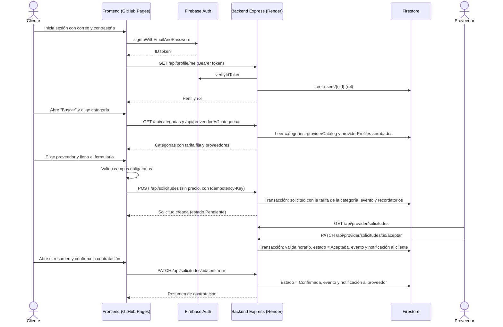
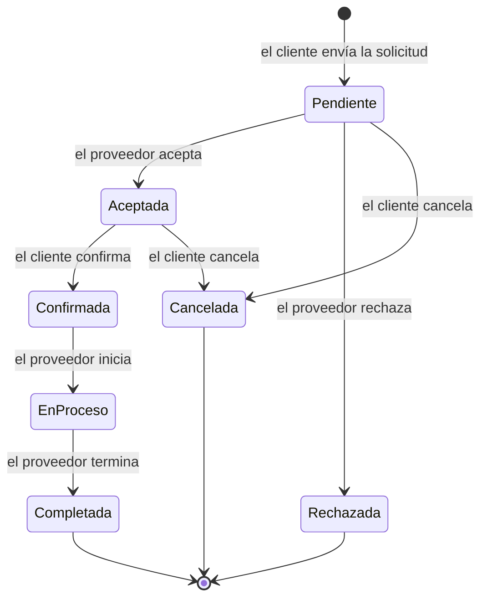
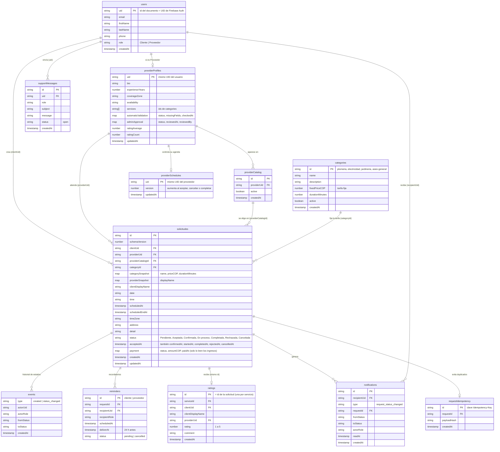
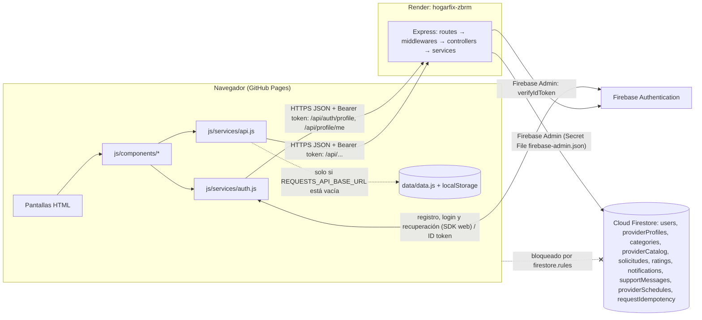

# 🌐 HogarFix
**Calidad en cada arreglo**

Proyecto enfocado en conectar a personas que necesitan servicios para el hogar con proveedores calificados, mediante una plataforma digital accesible, organizada y transparente que utiliza un modelo de tarifa fija por categoría de servicio.

## 📑 Contenido

1. [Objetivo general](#-1-objetivo-general)
2. [Contexto de uso](#-2-contexto-de-uso)
3. [Requerimientos del sistema](#-3-requerimientos-del-sistema)
4. [Diagramas UML](#-4-diagramas-uml)
5. [Prototipo en Figma](#-5-prototipo-en-figma)
6. [Modelo de datos](#%EF%B8%8F-6-modelo-de-datos)
7. [Documentación del sistema](#-7-documentación-del-sistema)
8. [Instalación y ejecución](#-8-instalación-y-ejecución)
9. [Despliegue](#-9-despliegue)
10. [Seguridad y archivos sensibles](#-10-seguridad-y-archivos-sensibles)
11. [Estado del proyecto](#-11-estado-del-proyecto)

## 👥 Integrantes

- Laura Valentina Bojacá Sánchez – 1202561
- Sebastián Gómez Ramírez – 1202821
- Juan José Gutiérrez – 1202997
- Sebastián Torres – 1202

## 🎯 1. Objetivo general

Desarrollar una plataforma digital que facilite la contratación de servicios para el hogar, como plomería, electricidad, jardinería y aseo general, conectando a clientes con proveedores calificados mediante un sistema de tarifas fijas por categoría. HogarFix busca solucionar los problemas de informalidad, falta de transparencia en los precios, incertidumbre sobre la disponibilidad de los proveedores y dificultades para encontrar personal de confianza. Para ello, permite consultar los precios antes de realizar una solicitud, programar los servicios, gestionar su aceptación y seguimiento, recibir notificaciones y calificar a los proveedores, mejorando así la confianza, la organización y la eficiencia durante el proceso de contratación.

## 🌍 2. Contexto de uso

HogarFix está dirigido a dos tipos principales de usuarios: los clientes que necesitan contratar servicios de reparación o mantenimiento para su hogar y los proveedores que ofrecen servicios técnicos u operativos, como plomería, electricidad, jardinería y aseo general.

Los clientes pueden utilizar la plataforma desde un dispositivo web o móvil para registrarse, consultar las categorías disponibles y sus tarifas fijas, elegir un proveedor aprobado de la categoría, solicitarle un servicio indicando la fecha, hora, ubicación y descripción del trabajo, confirmar el servicio cuando el proveedor lo acepte, cancelarlo si lo necesitan y calificar la atención recibida. Por su parte, los proveedores pueden gestionar su perfil, consultar las solicitudes que los clientes le envían, aceptarlas o rechazarlas, iniciar y finalizar el servicio, administrar sus servicios y consultar su historial e ingresos. Ambos usuarios pueden recibir notificaciones y acceder al módulo de soporte cuando necesiten ayuda.

## 📋 3. Requerimientos del sistema

### 3.1 Requerimientos funcionales

**RF01. Registro de usuarios:** El sistema debe permitir registrar usuarios con sus datos personales y seleccionar el tipo de cuenta: cliente o proveedor.

**RF02. Inicio de sesión:** El sistema debe permitir iniciar sesión mediante correo electrónico y contraseña (Firebase Authentication).

**RF03. Recuperación de contraseña:** El sistema debe permitir solicitar por correo instrucciones para restablecer la contraseña mediante Firebase Authentication.

**RF04. Consulta de categorías y tarifas:** El sistema debe mostrar las categorías de servicios para el hogar y sus respectivas tarifas fijas.

**RF05. Solicitud de servicios:** El sistema debe permitir al cliente solicitar un servicio indicando la categoría, fecha, hora, ubicación y descripción del trabajo requerido.

**RF06. Visualización de proveedores:** El sistema debe permitir al cliente consultar los proveedores aprobados de cada categoría, con su calificación promedio y reseñas, y elegir a cuál enviar la solicitud.

**RF07. Confirmación del servicio:** El sistema debe permitir al cliente confirmar un servicio aceptado por un proveedor y generar un resumen tipo factura con los datos de la contratación.

**RF08. Gestión de solicitudes:** El sistema debe permitir al proveedor consultar las solicitudes que le asignan los clientes y aceptarlas o rechazarlas sin modificar la tarifa fija; después de la confirmación del cliente, iniciarlas y finalizarlas.

**RF09. Historial de servicios:** El sistema debe permitir a clientes y proveedores consultar el historial y el estado de los servicios.

**RF10. Calificación del proveedor:** El sistema debe permitir al cliente calificar al proveedor de una a cinco estrellas y dejar un comentario una vez finalizado el servicio.

**RF11. Notificaciones:** El sistema debe notificar a los usuarios sobre los cambios de estado de las solicitudes y los recordatorios de los servicios programados.

**RF12. Soporte:** El sistema debe ofrecer preguntas frecuentes y permitir enviar mensajes al equipo de soporte.

**RF13. Gestión del perfil:** El sistema debe permitir a los usuarios consultar y editar su información personal y, en el caso del proveedor, gestionar sus categorías y disponibilidad.

**RF14. Consulta de ingresos:** El sistema debe permitir al proveedor consultar sus ingresos acumulados y su desglose por periodo a partir de los servicios pagados.

### 3.2 Requerimientos no funcionales

**RNF01. Usabilidad:** La interfaz debe ser intuitiva y facilitar la navegación de clientes y proveedores.

**RNF02. Diseño adaptable:** La plataforma debe presentar una interfaz responsive que se adapte a diferentes tamaños de pantalla y dispositivos.

**RNF03. Seguridad:** El sistema debe proteger la información de los usuarios mediante autenticación y reglas de acceso según el rol y los permisos correspondientes.

**RNF04. Integridad de tarifas:** Las tarifas deben mantenerse fijas según la categoría del servicio y no deben poder ser modificadas por el cliente ni por el proveedor durante la solicitud.

**RNF05. Sincronización:** La información de las solicitudes, servicios y notificaciones se guarda en Firestore a través del backend; las pantallas la consultan por la API y el historial del cliente se actualiza de forma periódica (cada 30 segundos y al volver a la pestaña).

**RNF06. Persistencia:** Los datos registrados deben almacenarse de forma persistente en la base de datos para permitir su consulta posterior.

**RNF07. Organización modular:** El sistema debe separar las funcionalidades de autenticación, gestión del cliente, gestión del proveedor, servicios, notificaciones y soporte para facilitar su mantenimiento y evolución.

## 🧠 4. Diagramas UML

### 4.1 Diagrama de casos de uso

Representa las funcionalidades principales de HogarFix y cómo interactúan con ellas el cliente, el proveedor y el sistema (que envía las notificaciones automáticas).


### 4.2 Diagrama de secuencia: solicitud de un servicio a tarifa fija

Todas las llamadas al backend llevan el ID token de Firebase en la cabecera `Authorization: Bearer …`; el backend lo verifica con Firebase Admin y toma el UID y el rol del token, nunca del cuerpo.



### 4.3 Estados de una solicitud



## 🎨 5. Prototipo en Figma

[Prototipo público de HogarFix en Figma](https://www.figma.com/design/QyHoaWKuAh0UaloG1XTRh8/HogarFix?node-id=532-421&t=BvIlGCNIAR99rQAw-1)

## 🗄️ 6. Modelo de datos

HogarFix guarda la información en **Cloud Firestore**. El backend Express (con Firebase Admin) es el único que lee y escribe las colecciones, incluido `users/{uid}`; el navegador no accede a Firestore y `firestore.rules` niega cualquier lectura o escritura directa. Los nombres de colecciones y campos de este diagrama son los mismos que usa el código en `backend/src/services/`.



`events` y `reminders` son subcolecciones de cada documento de `solicitudes` (`solicitudes/{id}/events` y `solicitudes/{id}/reminders`). Las preguntas frecuentes del módulo de soporte son contenido fijo del backend y no se guardan en Firestore.

**Reglas del modelo**

- La tarifa no la envía el cliente: el backend copia `fixedPriceCOP` de `categories` en `categorySnapshot.priceCOP` al crear la solicitud.
- Un proveedor solo recibe solicitudes si su perfil está completo, pasó la validación automática, tiene aprobación administrativa y ofrece esa categoría en `services`.
- Cada servicio completado admite una sola calificación: el documento de `ratings` usa el mismo id de la solicitud.
- Cada cambio de estado guarda, en la misma transacción, un `event` y una `notification` para la otra persona. Crear la solicitud guarda el evento `created` y los recordatorios, pero no genera notificación.
- Al aceptar, el backend revisa que el proveedor no tenga otro servicio en ese horario y actualiza la versión de `providerSchedules/{uid}`, para que dos aceptaciones simultáneas no ocupen el mismo horario.
- Los ingresos (`/api/provider/earnings`) solo suman solicitudes con `payment.status = "paid"`. Como todavía no hay pasarela de pago, ningún flujo escribe ese campo y el total real es $0.

**Modo demostración:** si `REQUESTS_API_BASE_URL` se deja vacía en `js/config.js`, el frontend usa `data/data.js` para categorías y proveedores y guarda las solicitudes en el `localStorage` del navegador, con los nombres de campo de `data/schema.json`. El chat siempre se guarda en `localStorage`. El inicio de sesión y los perfiles necesitan `PROFILE_API_BASE_URL`, porque el perfil se lee del backend.

**Tarifas fijas actuales**

| Categoría | ID | Tarifa |
| --- | --- | --- |
| Plomería | `plomeria` | $35.000 |
| Electricidad | `electricidad` | $40.000 |
| Jardinería | `jardineria` | $40.000 |
| Aseo general | `aseo-general` | $35.000 |

## 🧩 7. Documentación del sistema

### 7.1 Tecnologías

| Capa | Tecnología |
| --- | --- |
| Frontend | HTML5, CSS3 (diseño responsive con media queries), JavaScript (módulos ES) |
| Backend | Node.js + Express: autenticación, perfiles, solicitudes, calificaciones, notificaciones, soporte e ingresos |
| Base de datos y autenticación | Firebase Authentication (cuentas y tokens) y Cloud Firestore, al que solo accede el backend |
| Despliegue | GitHub Pages (frontend, rama `main`) y Render (backend Node.js, rama `main`) |
| Diseño | Figma |
| Control de versiones y publicación | Git, GitHub y GitHub Pages |
| Formato de código | Prettier (`.prettierrc.json`) |
| Pruebas | `node:test` (backend) y Firebase Emulator para pruebas de integración |

### 7.2 Arquitectura



- **Frontend:** cada pantalla es un archivo HTML que carga `js/main.js`. `main.js` importa los módulos de `js/components/`, y cada módulo actúa solo si encuentra sus elementos en la página.
- **Autenticación (`js/services/auth.js`):** Firebase Authentication gestiona registro e inicio de sesión. El navegador crea el perfil inicial y consulta/actualiza perfiles mediante rutas backend autenticadas; no lee ni escribe Firestore directamente.
- **Capa de servicios (`js/services/api.js`):** perfiles, categorías, proveedores, solicitudes, calificaciones, notificaciones y soporte se consultan por rutas REST del backend (`js/config.js` apunta a `https://hogarfix-zbrm.onrender.com/api`). Si `REQUESTS_API_BASE_URL` se deja vacía, el catálogo y las solicitudes usan los datos locales de demostración.
- **Backend (`backend/`):** Express expone `GET /api/health` y las rutas de registro del perfil, identidad, perfiles, catálogo público, especialidades y disponibilidad, solicitudes (crear, confirmar, cancelar, aceptar, rechazar, iniciar y completar), calificaciones, notificaciones, soporte, ingresos del proveedor y aprobación administrativa (sección 7.4). Firebase Admin verifica firma, vencimiento y revocación del ID token; el rol se obtiene del perfil `users/{uid}` usando el UID verificado. Los errores se responden con un formato común (`status`, `code`, `message`) desde `middlewares/error-handler.js`.
- **Firebase:** Firebase Authentication gestiona las cuentas, las contraseñas y la sesión; Firestore guarda todos los datos (sección 6). El backend usa Firebase Admin con Application Default Credentials (en Render, el Secret File `firebase-admin.json`), que omite las reglas de Firestore; por ello las rutas validan explícitamente sus campos y permisos.

### 7.3 Estructura de carpetas

```
HogarFix/
├── index.html                 Página pública (landing)
├── login.html, registro.html  Acceso
├── app.html                   Panel del cliente
├── buscar.html                Catálogo de categorías y búsqueda de proveedores
├── perfil-proveedor.html      Perfil del proveedor y formulario de solicitud
├── reserva.html               Resumen de contratación y confirmación
├── solicitudes.html           Historial de servicios del cliente
├── mi-perfil-cliente.html     Perfil editable del cliente
├── chat.html                  Chat del cliente
├── inicio-proveedor.html      Panel del proveedor
├── solicitudes-proveedor.html Solicitudes recibidas por el proveedor
├── detalle-proveedor.html     Detalle de una solicitud (proveedor)
├── mi-perfil-proveedor.html   Perfil editable del proveedor
├── ingresos-proveedor.html    Ingresos y calificación del proveedor
├── mensajes-proveedor.html    Chat del proveedor
├── notificaciones.html        Notificaciones del usuario
├── soporte.html               Preguntas frecuentes y formulario de soporte
├── prueba.html                Página de prueba de conexión con Firebase (usa js/prueba-firebase.js)
├── assets/                    Logos, íconos SVG e imágenes
├── css/styles.css             Estilos globales y media queries
├── data/
│   ├── data.js                Datos de demostración (categorías, proveedores, reseñas…)
│   └── schema.json            Esquema de los formularios y entidades
├── js/
│   ├── config.js              URL de la API backend
│   ├── firebase-config.js     Firebase web SDK (Authentication)
│   ├── prueba-firebase.js     Script de la página de prueba de Firebase
│   ├── main.js                Navegación, accesibilidad y sesión
│   ├── utils.js               Formato de precios y fechas, estados de carga y error
│   ├── services/
│   │   ├── api.js             Capa de servicios (backend o demostración)
│   │   └── auth.js            Firebase Authentication y perfiles de usuario
│   └── components/
│       ├── catalogo.js        Categorías y tarifas fijas (ISSUE 10)
│       ├── proveedores.js     Listado y perfil de proveedores (ISSUE 12)
│       ├── solicitud.js       Formulario de solicitud con validación y método de pago demo (ISSUE 11, #38)
│       ├── resumen.js         Resumen y confirmación de contratación (ISSUE 13)
│       ├── historial.js       Historial, filtros y calificación de servicios (ISSUE 14, 25)
│       ├── form-data.js       Lectura y validación de formularios contra schema.json
│       ├── panel-proveedor.js Panel, solicitudes, ingresos y calificación del proveedor (#29, 20, 25)
│       ├── perfil-cliente.js  Perfil del cliente (#30)
│       ├── perfil-proveedor.js Perfil, especialidades y disponibilidad del proveedor (#31, 19)
│       ├── password.js        Mostrar/ocultar y requisitos de contraseña (#32)
│       ├── service-center.js  Notificaciones y soporte (ISSUE 26)
│       └── login.js, registro.js, buscar.js, chat.js
├── backend/
│   ├── README.md              Instalación, endpoints y pruebas del backend
│   ├── .env.example           Variables de entorno del backend
│   ├── package.json           Dependencias y comandos (start, test, test:emulator, seed:catalog, admin:grant, deploy:firestore)
│   ├── package-lock.json      Versiones bloqueadas de dependencias
│   ├── src/
│   │   ├── app.js             Aplicación Express y montaje de rutas
│   │   ├── server.js          Inicio del servidor y configuración del puerto
│   │   ├── config/firebase-admin.js  Inicialización diferida de Firebase Admin
│   │   ├── middlewares/       auth.js (token y rol), validate.js, error-handler.js
│   │   ├── controllers/       admin, earnings, profile y request (catálogo, registro y soporte responden desde sus rutas)
│   │   ├── routes/            access, admin, auth-profile, catalog, profile, requests, earnings y support
│   │   └── services/          catálogo, perfiles, solicitudes, calificaciones, notificaciones, soporte e ingresos
│   ├── scripts/               seed-catalog.js (catálogo), set-admin-claim.js (claim admin), run-emulator-tests.js
│   └── test/
│       ├── app.test.js, error-handling.test.js           Aplicación y manejo de errores
│       ├── catalog-service.test.js                       Catálogo backend
│       ├── auth-middleware.test.js, profile-routes.test.js  Autenticación, roles y perfiles
│       ├── request-routes.test.js, request-service.test.js, request-validation.test.js  Solicitudes
│       ├── calificaciones-soporte.test.js                Calificaciones, notificaciones y soporte
│       ├── earnings-routes.test.js                       Ingresos del proveedor
│       └── integration/                                  Pruebas con Firebase Emulator
├── firebase.json              Reglas, índices y configuración de Emulator
├── firestore.indexes.json     Índices compuestos de solicitudes
├── firestore.rules            Reglas de Firestore (niegan el acceso directo desde el navegador)
├── render.yaml                Configuración del servicio de Render (referencia)
├── .env.example               Variables de entorno de ejemplo
└── .prettierrc.json           Formato común del código
```

### 7.4 Endpoints principales

Todas las rutas llevan el prefijo `/api` y se sirven desde `https://hogarfix-zbrm.onrender.com`. Son públicas `GET /api/health` y el catálogo (`/categorias`, `/proveedores`); las demás exigen `Authorization: Bearer <ID token de Firebase>`. La tabla completa con el rol exigido por cada ruta está en [`backend/README.md`](backend/README.md).

| Método | Ruta | Uso | Respuesta |
| --- | --- | --- | --- |
| GET | `/health` | Comprobar que el servidor está en línea (público) | `{ status, message }` |
| POST | `/auth/profile` | Crear el perfil inicial al registrarse (nombre, apellido y rol); el correo y el UID salen del token | `{ profile: {...} }` |
| GET | `/categorias` | Categorías activas con su tarifa fija (público) | `{ categories: [...] }` |
| GET | `/proveedores?categoria=` | Proveedores aprobados del catálogo, filtrables por categoría (público) | `{ providers: [...] }` |
| GET | `/proveedores/:id` | Perfil público de un proveedor con sus reseñas (público) | `{ provider: {...} }` |
| GET | `/client/me`, `/provider/me` | Identidad del token según el rol | `{ user: {...} }` |
| GET | `/solicitudes` | Solicitudes del cliente autenticado | `{ requests: [...] }` |
| GET | `/solicitudes/:id` | Detalle de una solicitud propia | `{ request: {...} }` |
| POST | `/solicitudes` | Crear solicitud con `providerCatalogId`, `categoryId`, fecha, hora, dirección y detalle; requiere `Idempotency-Key` | `{ request: {...} }` |
| PATCH | `/solicitudes/:id/confirmar` | El cliente confirma una solicitud aceptada | `{ request: {...} }` |
| PATCH | `/solicitudes/:id/cancelar` | El cliente cancela una solicitud pendiente o aceptada | `{ request: {...} }` |
| GET | `/solicitudes/:id/calificacion` | Consultar si el cliente ya calificó un servicio propio | `{ rating: {...} }` o `{ rating: null }` |
| POST | `/solicitudes/:id/calificacion` | Calificar un servicio completado (1–5 estrellas y comentario) | `{ rating: {...} }` |
| GET | `/provider/:uid/calificaciones` | Consultar promedio, cantidad y reseñas de un proveedor | `{ summary: { average, count, ratings } }` |
| GET | `/provider/solicitudes` | Solicitudes asignadas al proveedor autenticado | `{ requests: [...] }` |
| GET | `/provider/solicitudes/:id` | Detalle de una solicitud asignada | `{ request: {...} }` |
| PATCH | `/provider/solicitudes/:id/aceptar` | Aceptar solicitud si el proveedor es elegible | `{ request: {...} }` |
| PATCH | `/provider/solicitudes/:id/rechazar` | Rechazar solicitud asignada | `{ request: {...} }` |
| PATCH | `/provider/solicitudes/:id/iniciar` | Iniciar una solicitud confirmada | `{ request: {...} }` |
| PATCH | `/provider/solicitudes/:id/completar` | Finalizar una solicitud en proceso | `{ request: {...} }` |
| GET | `/notifications` | Notificaciones recientes del usuario autenticado | `{ notifications: [...] }` |
| PATCH | `/notifications/:id/read` | Marcar como leída una notificación propia | `{ notification: {...} }` |
| GET | `/support/faqs` | Consultar preguntas frecuentes | `{ faqs: [...] }` |
| POST | `/support/messages` | Crear un caso de soporte (`subject`, `message`) | `{ message: {...} }` |
| GET/PATCH | `/profile/me` | Consultar/actualizar datos personales propios | Perfil personal |
| GET/PATCH | `/provider/profile/me` | Consultar/actualizar datos profesionales propios | Perfil y estados de validación/aprobación |
| GET | `/provider/eligibility` | Verificar validación, aprobación y cuenta activa | `{ eligibility: {...} }` |
| GET/PATCH | `/provider/especialidades` | Consultar/actualizar las categorías que ofrece el proveedor | Especialidades del proveedor |
| GET/PATCH | `/provider/disponibilidad` | Consultar/actualizar días y horarios de atención | Disponibilidad del proveedor |
| GET | `/provider/earnings` | Ingresos del proveedor por servicios con pago confirmado, filtrables por fechas | Totales del periodo |
| GET | `/provider/earnings/breakdown` | Ingresos agrupados por día, mes o año | Desglose por periodo |
| PATCH | `/admin/providers/:uid/approval` | Decisión administrativa (claim `admin: true`) | Estado de aprobación actualizado |

Reglas importantes para el backend:

- `POST /solicitudes` **no recibe precio ni datos de pago**: el servidor copia la tarifa fija de `categories/{categoryId}`. Los identificadores deben corresponder a documentos reales del catálogo y la cabecera `Idempotency-Key` es obligatoria.
- Los métodos y estados de pago existen solo en las solicitudes de demostración. No hay endpoint ni pasarela de pago; el modo backend no envía datos de pago ni simula cobros.
- Las rutas de proveedor y perfil obtienen UID y rol del token Firebase verificado; un proveedor solo puede ver y cambiar solicitudes asignadas a su cuenta.
- Los perfiles se guardan en `users/{uid}` y `providerProfiles/{uid}`; el cliente no puede enviar UID, rol, validación automática ni aprobación.
- Los errores responden con un código HTTP y `{ "status": "error", "code": "PROVIDER_SCHEDULE_CONFLICT", "message": "texto para el usuario" }`; el frontend muestra `message`. Los errores no previstos responden 500 sin detalles internos y los fallos de Firebase, 503.
- Las pantallas no usan todavía `/provider/especialidades`, `/provider/disponibilidad` (el perfil profesional se edita con `/provider/profile/me`), `/provider/earnings`, `/client/me`, `/provider/me` ni la ruta administrativa; están disponibles en la API y cubiertas por pruebas.
- Las rutas de aprobación requieren el custom claim `admin: true`, que se asigna con `npm run admin:grant`. Las calificaciones se guardan una vez por servicio en `ratings/{serviceId}`; el promedio y la cantidad se mantienen en `providerProfiles/{uid}`.
- Al aceptar, el backend rechaza la solicitud si el proveedor ya tiene otro servicio asignado en ese horario (`PROVIDER_SCHEDULE_CONFLICT`).
- Cada transición válida de una solicitud escribe de forma atómica su evento y una notificación para la otra persona participante. Las notificaciones se consultan por el UID autenticado y solo su destinatario puede marcarlas como leídas. Al crear una solicitud se preparan recordatorios para cliente y proveedor, con entrega prevista 24 horas antes; cancelación, rechazo o finalización los marca como cancelados para que un worker pueda ignorarlos. Los mensajes de soporte se guardan en `supportMessages`; las preguntas frecuentes son contenido estático del backend.

### 7.5 Funcionalidades del frontend

- **Catálogo y tarifas:** `buscar.html` muestra las categorías activas de `/api/categorias` con su tarifa fija; al elegir una se filtran los proveedores. La landing toma los mismos precios.
- **Proveedores:** tarjetas con especialidad, calificación, zona y disponibilidad de los proveedores aprobados (`/api/proveedores`); filtros por texto, categoría y disponibilidad; perfil con reseñas reales de `ratings`.
- **Solicitud de servicio:** categoría (entre las que ofrece el proveedor), fecha (hoy a 60 días), hora, dirección y descripción; la tarifa no se puede editar. Se envía al backend con `providerCatalogId` e `Idempotency-Key` y sin campos de pago. Solo una cuenta Cliente puede enviarla.
- **Resumen de contratación:** datos del cliente, del proveedor, del servicio y la tarifa, tipo factura, con opción de imprimir. Si el proveedor ya aceptó, el cliente confirma desde ahí.
- **Métodos de pago:** solo en modo demostración se elige efectivo, Nequi, PSE o tarjeta como opción informativa. Con el backend activo el formulario no muestra métodos de pago; no existe endpoint ni pasarela de pago.
- **Perfiles:** el cliente (`mi-perfil-cliente.html`) y el proveedor (`mi-perfil-proveedor.html`) editan campos admitidos por el backend. Foto y almacenamiento de archivos requieren integrar Firebase Storage.
- **Panel del proveedor:** en backend muestra solicitudes asignadas y bloquea aceptar si la elegibilidad no está confirmada. En demo muestra datos de ejemplo señalados como tales; sus tarifas no representan pagos.
- **Contraseñas:** botón de ojo para mostrar u ocultar; el mínimo de 8 caracteres y la coincidencia se validan para registrar. Los requisitos visuales adicionales son recomendaciones, no condiciones de Firebase Authentication.
- **Historial:** filtros por estado y rango de fechas, orden, detalles desplegables, botón para cancelar las solicitudes pendientes o aceptadas, calificación de servicios completados y actualización automática (cada 30 s, al volver a la pestaña o cuando cambia en otra pestaña).
- **Ingresos del proveedor:** `ingresos-proveedor.html` muestra el valor estimado de los servicios completados, calculado con las tarifas de las solicitudes que devuelve `/api/provider/solicitudes`, y la calificación promedio. No son pagos procesados.
- **Notificaciones y soporte:** `notificaciones.html` lista los cambios de estado y permite marcarlos como leídos; `soporte.html` muestra las preguntas frecuentes y envía mensajes a `supportMessages`.
- **Chat:** `chat.html` y `mensajes-proveedor.html` guardan los mensajes solo en el `localStorage` del navegador; no se sincronizan entre cuentas.
- **Estados de carga y error** en todas las consultas, con botón para reintentar.
- **Diseño responsive** probado a 360 px (celular), 768 px (tablet) y 1280 px (escritorio), sin desbordamiento horizontal.
- **Accesibilidad:** enlace para saltar al contenido, botones para aumentar el texto y alto contraste, etiquetas ARIA y navegación por teclado.

## 🚀 8. Instalación y ejecución

**Requisitos:** un navegador actualizado y Visual Studio Code con la extensión **Live Server** (o cualquier servidor estático). No hace falta instalar dependencias.

1. Clona el repositorio:
   ```bash
   git clone https://github.com/Tecnologias-2026-2/HogarFix.git
   cd HogarFix
   ```
2. Abre la carpeta en Visual Studio Code.
3. Clic derecho en `index.html` → **Open with Live Server**. Se abre en `http://127.0.0.1:5500`.

> Abrir el HTML con doble clic (`file://`) no funciona: los módulos de JavaScript y `schema.json` necesitan un servidor.

> `js/config.js` apunta al backend publicado en Render. Para usarlo desde Live Server, el origen `http://127.0.0.1:5500` debe estar en `CORS_ORIGINS` del servicio de Render; si no, ejecuta el backend local y cambia las URLs a `http://localhost:3000/api`.

Alternativa sin VS Code: `npx serve .` o `python -m http.server 5500` desde la carpeta del proyecto.

**Backend y pruebas (opcional, requiere Node.js 22 o superior):**

```bash
cd backend
npm install
npm test          # pruebas automatizadas (no necesitan Firebase)
npm start         # inicia la API en http://localhost:3000 (requiere backend/.env)
```

Las pruebas de integración con Firebase Emulator (`npm run test:emulator`) y la configuración de credenciales se explican en [`backend/README.md`](backend/README.md).

### Recorrido de demostración

Con el catálogo sembrado y al menos un proveedor aprobado (ver *Orden de publicación*, sección 9):

1. Abre `/api/health` en el backend para despertarlo (el plan gratuito de Render tarda cerca de 50 segundos la primera vez).
2. En `index.html` elige **Soy Cliente** y regístrate con datos de prueba (no uses contraseñas reales).
3. En **Buscar** elige una categoría, abre el perfil de un proveedor y envía una solicitud.
4. Con la cuenta del proveedor, en **Mis Solicitudes**, acéptala.
5. Con la cuenta del cliente, abre el resumen y **confirma** la contratación.
6. El proveedor la **inicia** y la **completa**; el cliente la **califica** desde **Mis Solicitudes**.
7. Revisa **Notificaciones** con cada cuenta y prueba **Soporte**.
8. Para mostrar los estados de error, agrega `?simularError=1` a la URL (por ejemplo `buscar.html?simularError=1`).

### Conectar el backend

`js/config.js` define las dos URLs del backend:

```js
export const PROFILE_API_BASE_URL = "https://hogarfix-zbrm.onrender.com/api";
export const REQUESTS_API_BASE_URL = "https://hogarfix-zbrm.onrender.com/api";
```

Para desarrollo local, reemplázalas por `http://localhost:3000/api`, configura `backend/.env` a partir de `backend/.env.example` (incluidas `FIREBASE_PROJECT_ID` y `CORS_ORIGINS`) y define `GOOGLE_APPLICATION_CREDENTIALS` con la ruta a la clave de Firebase Admin guardada fuera del repositorio. Las reglas e índices están declarados en `firebase.json`; el backend valida sus propias escrituras porque Admin SDK omite las reglas.

Los perfiles se guardan en `users/{uid}` (datos personales) y `providerProfiles/{uid}` (datos profesionales y estados controlados por servidor). Los usuarios no pueden cambiar correo, rol, UID, validación automática ni aprobación desde las rutas de perfil. Una edición profesional reinicia la aprobación a `pending`; el perfil completo puede superar la validación automática, pero solo una cuenta con claim administrativo puede aprobarlo. Foto y certificados quedan pendientes de configurar Firebase Storage.

### Modo demostración

Si `REQUESTS_API_BASE_URL` se deja vacía, categorías, proveedores y solicitudes usan los datos locales de `data/data.js` y `localStorage`, y el formulario muestra los métodos de pago informativos (sin cobros). `PROFILE_API_BASE_URL` debe seguir configurada, porque el registro, el inicio de sesión y los perfiles pasan por el backend.

## 🌍 9. Despliegue

El frontend se publica en **GitHub Pages** directamente desde la rama `main`: cada push a `main` dispara el proceso automático de GitHub *"pages build and deployment"* (pestaña *Actions*) y en uno o dos minutos el sitio queda actualizado.

Configuración (ya está hecha; la cambia solo quien administra el repositorio): **Settings → Pages → Build and deployment → Source: Deploy from a branch**, rama `main`, carpeta `/ (root)`.

Como se publica la raíz del repositorio, la carpeta `backend/` también queda visible como archivos estáticos (sin ejecutarse). No contiene secretos: las credenciales van en `.env` o en el Secret File de Render, excluidos por `.gitignore`.

El sitio queda en `https://tecnologias-2026-2.github.io/HogarFix/`.

### Backend en Render

El backend Express se ejecuta en **Render** como *Web Service*: **https://hogarfix-zbrm.onrender.com** (comprobación: [`/api/health`](https://hogarfix-zbrm.onrender.com/api/health)). `js/config.js` apunta a `https://hogarfix-zbrm.onrender.com/api`.

| Ajuste en Render | Valor |
| --- | --- |
| Rama que despliega | `main` (cada push a `main` redespliega en unos 2 minutos) |
| Root Directory | `backend` |
| Build Command | `npm ci` |
| Start Command | `npm start` (`node src/server.js`; el puerto lo asigna Render en `PORT`) |
| Variables de entorno | `FIREBASE_PROJECT_ID=hogarfix-f9f56`, `CORS_ORIGINS=https://tecnologias-2026-2.github.io`, `GOOGLE_APPLICATION_CREDENTIALS=/etc/secrets/firebase-admin.json` |
| Secret File | `firebase-admin.json` (clave de la cuenta de servicio de Firebase Admin; nunca se sube al repositorio) |

El servicio se creó a mano en el panel de Render. [`render.yaml`](render.yaml) documenta los mismos valores y solo se usaría para crear un Blueprint nuevo.

El plan gratuito de Render suspende el servicio tras unos minutos sin uso; la primera petición (incluido el inicio de sesión) puede tardar cerca de 50 segundos. Antes de una demostración, abre `/api/health` para despertarlo.

### Orden de publicación

Los pasos con credenciales de Firebase se ejecutan desde un PC, con la clave guardada fuera del repositorio (el Shell de Render es de pago).

1. Corregir y probar en `Dev`: `cd backend && npm ci && npm test`.
2. Pasar `Dev` → `main`. GitHub Pages y Render se actualizan por separado; espera a que Render muestre **Live** con el commit nuevo.
3. Probar registro e inicio de sesión en la página publicada.
4. Solo después de que `main` tenga el código nuevo, publicar reglas e índices: `npm run deploy:firestore`. Si se publican antes, el frontend anterior (que leía `users` directamente) no podría iniciar sesión.
5. Sembrar el catálogo con `npm run seed:catalog`, aprobar un proveedor de prueba con perfil completo (`adminApproval.status = "approved"` en la consola de Firebase, o con `npm run admin:grant` y la ruta administrativa) y repetir `npm run seed:catalog` con `PROVIDER_CATALOG_JSON` que incluya el UID de ese proveedor.
6. Probar el flujo completo: buscar → solicitar → aceptar → confirmar → iniciar → completar → calificar.

## 🔒 10. Seguridad y archivos sensibles

- `.gitignore` excluye `.env` y sus variantes; usa `.env.example` como plantilla y nunca subas el `.env` real.
- Las contraseñas se gestionan mediante Firebase Authentication; Firestore solo recibe los campos del perfil y nunca la contraseña, su confirmación ni hashes.
- El formulario exige un mínimo de 8 caracteres; los requisitos visuales adicionales no sustituyen las reglas vigentes de Firebase Authentication.
- No se piden ni guardan datos de tarjetas. Los métodos y estados de pago son exclusivamente informativos en el modo demostración.
- La configuración web de Firebase (`apiKey`, `projectId`…) es pública por diseño, pero el acceso a los datos debe protegerse con **reglas de seguridad de Firestore** por usuario y rol.
- Firebase Admin usa Application Default Credentials y `FIREBASE_PROJECT_ID`. En Render, la clave se carga como Secret File `firebase-admin.json` y `GOOGLE_APPLICATION_CREDENTIALS` apunta a `/etc/secrets/firebase-admin.json`. `.gitignore` excluye `firebase-admin.json` y los nombres habituales de claves de cuentas de servicio; nunca se suben a GitHub.
- El control de acceso de las pantallas mejora la navegación, pero la autorización de los datos debe imponerse en el backend. La aprobación de proveedores requiere el claim administrativo. `firestore.rules` niega toda operación directa desde el navegador y se publica junto con los índices con `npm run deploy:firestore` (paso 4 del orden de publicación).
- Lista de revisión antes de cada entrega: sin archivos `.env` ni credenciales de cuentas de servicio. Como GitHub Pages publica la raíz del repositorio, la página de prueba `prueba.html` (con `js/prueba-firebase.js`) también queda publicada; no contiene credenciales privadas.

## 📌 11. Estado del proyecto

Los números 01-28 reflejan el plan de trabajo anterior; las filas identificadas como `GitHub #...` indican el número real del Issue cuando la numeración difiere.

| Issue | Tema | Estado |
| --- | --- | --- |
| 01 | Estructura general del proyecto | ✅ Estructura y documentación base |
| 02 | Servidor Node.js + Express | ✅ Servidor, `GET /api/health` y rutas de negocio |
| 03-07 | Autenticación, autorización y perfiles | ✅ Firebase Authentication, autorización backend y edición de perfiles |
| 08 | Adaptación del diseño a HTML, CSS y JS | ✅ Código formateado y organizado, íconos de categorías corregidos |
| 09 | Diseño responsive | ✅ Probado en celular, tablet y escritorio |
| 10 | Catálogo de categorías y tarifas | ✅ Desde `/api/categorias` (requiere sembrar `categories`) |
| 11 | Formulario de solicitud | ✅ Validación y envío por la capa de servicios |
| 12 | Visualización de proveedores | ✅ Desde `/api/proveedores`, solo proveedores aprobados, con carga y error |
| 13 | Confirmación y resumen de contratación | ✅ |
| 14 | Historial de servicios del cliente | ✅ Filtros por estado y fecha, cancelación y calificación |
| Autenticación | Registro, inicio y cierre de sesión con Firebase Authentication; el perfil `users/{uid}` lo crea y lee el backend | ✅ |
| Administración de proveedores | Estados y aprobación administrativa segura | ✅ Ruta administrativa protegida por claim |
| GitHub #11 | Middleware de autenticación y autorización | ✅ Verificación de ID token y guards Cliente/Proveedor |
| 28 | Documentación y entrega final | ✅ Este README |
| #29 (34) | Solicitudes iniciales del panel del proveedor | ✅ Sin datos de prueba, solo las del proveedor autenticado |
| #30 (35) | Perfil del cliente | ✅ Consulta y edición de datos personales |
| #31 (36) | Perfil del proveedor | ✅ Edición, validación automática y aprobación administrativa |
| #32 (37) | Contraseñas en el registro | ✅ Mostrar/ocultar y requisitos en vivo |
| #32 (38) | Métodos de pago | ✅ Opciones informativas del modo demostración; integración de cobros pendiente |
| 15-18 | Rutas, controladores y gestión de solicitudes | ✅ Crear, confirmar, cancelar, aceptar, rechazar, iniciar y completar, con eventos de estado |
| 19 | Especialidades y disponibilidad del proveedor | ✅ Endpoints `/provider/especialidades` y `/provider/disponibilidad` |
| 20 | Ingresos del proveedor | ✅ Endpoints `/provider/earnings` y `/provider/earnings/breakdown` (cuentan solo pagos confirmados); la pantalla muestra el valor estimado de servicios completados |
| 21 | Validaciones y manejo de errores | ✅ Middleware `validate` y `error-handler` con formato común |
| 22 | Modelo de datos | ✅ Sección 6 de este README |
| 23-24 | Firebase Admin y operaciones en Firestore | ✅ Configuración centralizada y servicios del backend |
| 25 | Calificaciones de proveedores | ✅ 1 a 5 estrellas, una por servicio y promedio por proveedor |
| 26 | Notificaciones y soporte | ✅ API y pantallas de notificaciones y soporte; los recordatorios esperan un worker externo |
| 27 | Pruebas e integración | 🟡 `npm test`: 90 pruebas en verde en 10 archivos; falta la evidencia con Postman/Thunder Client |
| Despliegue | Frontend en GitHub Pages y backend en Render | ✅ `https://hogarfix-zbrm.onrender.com` (rama `main`) |
